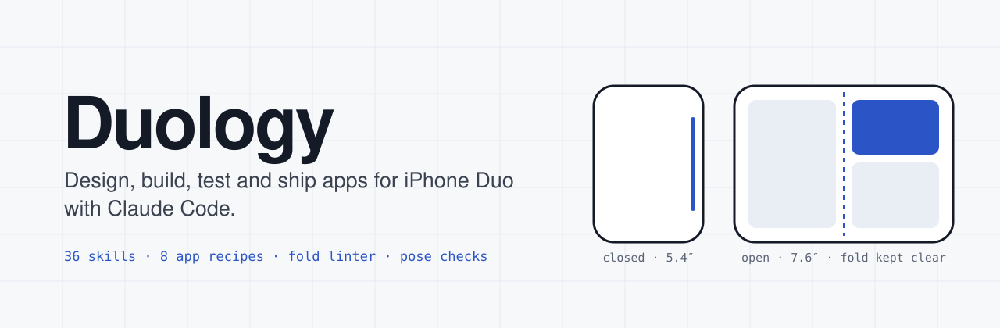
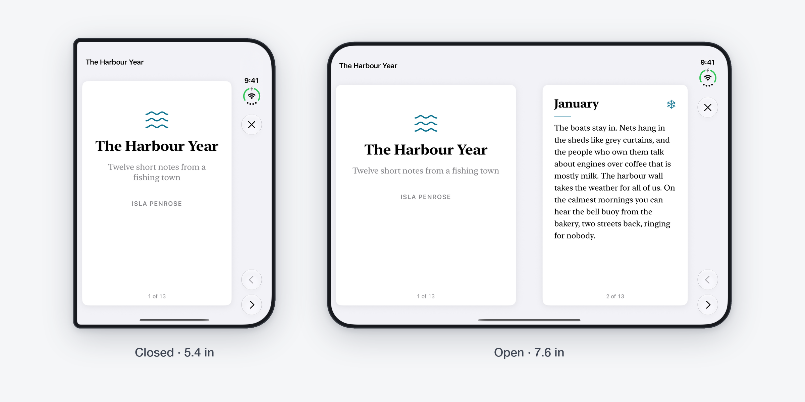
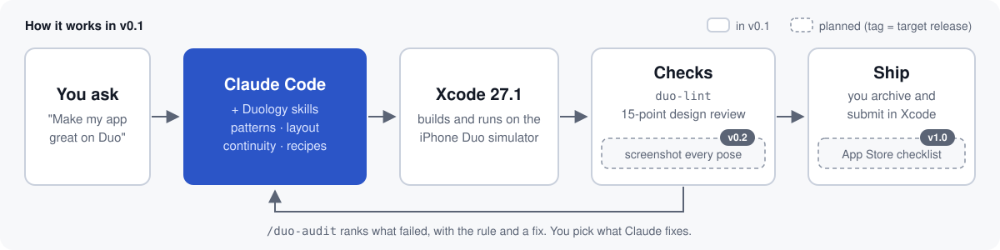

<div align="center">

**English** · [Français](docs/readme/README_fr.md)

<picture>
  <source media="(prefers-color-scheme: dark)" srcset="docs/assets/banner-dark.svg" />
  <source media="(prefers-color-scheme: light)" srcset="docs/assets/banner-light.svg" />
  
</picture>

# Duology

### Claude Code skills for designing, building, testing and shipping apps on iPhone Duo.

**Your agent learned iOS before the iPhone Duo existed. Duology teaches it the rest.**

[](https://github.com/Kimeur/duology/stargazers)
[](ROADMAP.md)
[](#whats-inside)
[](#app-recipes)
[](#verified-on)
[](#quick-start)
[](https://skills.sh/Kimeur/duology)
[](https://github.com/Kimeur/duology/commits)
[](LICENSE)

<!-- Trendshift badge: add once the repo is listed (trendshift.io assigns the id)
<a href="https://trendshift.io/repositories/ID" target="_blank" rel="noopener noreferrer"></a>
-->

[Quick start](#quick-start) · [What's inside](#whats-inside) · [Patterns](#layout-patterns) · [Recipes](#app-recipes) · [Proof](#proof-not-promises) · [FAQ](#faq) · [Roadmap](ROADMAP.md)

<code>/plugin marketplace add Kimeur/duology</code>

</div>

> [!IMPORTANT]
> **Duology is being built in the open.** v0.1 (11 skills, `/duo-doctor`, `/duo-new`, `/duo-audit`) lands by 30 October 2026. The full pack of 36 skills is planned for v1.0 in January 2027. Until v0.1 is tagged, the install commands below won't work yet. Star or watch the repo to get the release. See the [roadmap](ROADMAP.md).

> [!NOTE]
> Duology is a community project. It is not affiliated with, endorsed by or sponsored by Apple Inc.
> iPhone is a trademark of Apple Inc. Every API claim links to Apple's own documentation in [`reference/sources.md`](reference/sources.md).

<div align="center">
<br />
<picture>
  <source media="(prefers-color-scheme: dark)" srcset="docs/assets/hero-dark.png" />
  <source media="(prefers-color-scheme: light)" srcset="docs/assets/hero-light.png" />
  
</picture>
<br />
<sub>Real screenshots of the <a href="samples/DuologyGallery">gallery app</a> on the iPhone Duo simulator (iOS 27.1), drawn at the same scale.</sub>
<br /><br />
</div>

---

## The problem

iPhone Duo is in stores from 23 October 2026. It has a 5.4″ outer display, a 7.6″ inner display and a fold. Coding agents were trained before it existed, so when you ask one to "make this work on Duo" it writes code Apple tells you not to write:

- it measures `UIScreen.main.bounds`, which is ambiguous on a phone with two displays;
- it branches on device orientation or `userInterfaceIdiom` and treats "regular width" as "iPad";
- it puts buttons and text where the phone folds;
- it rebuilds the screen when you unfold, so you lose your scroll position, your typing or your video;
- it designs one screen and stretches it, instead of a layout for each way people hold the phone.

Apple published the rules in six Tech Talks, a HIG page and the iOS 27.1 SDK. Duology turns them, plus what we learned shipping a real Duo app, into skills Claude Code loads when it needs them.

### How Duology fixes it

1. **It knows the device.** Size classes, reserved regions, `ArrangementView`, vertical bars and the hinge. Each fact is checked against the iOS 27.1 SDK. Scenes and the cameras get their own skills in v0.2 and v0.3.
2. **It designs, not just compiles.** Eight named layout patterns, state that survives fold and unfold, and two people on one screen, each with SwiftUI code. Guidance for each pose, transitions and thumb reach follow in v0.2.
3. **It builds whole apps.** A recipe creates a project that builds and runs on the iPhone Duo simulator. v0.1 has the first one, a two-player game. Seven more are planned.
4. **It checks its own work.** `duo-lint` finds code Apple warns against. `/duo-audit` adds a 15-point design checklist on screenshots from the simulator. A pose check that screenshots every pose (`/duo-poses`) is planned for v0.2.

<div align="center">

</div>

## Quick start

<details open>
<summary><strong>Claude Code</strong> · plugin marketplace</summary>

**You need:** a Mac with Apple silicon, [Xcode 27.1](https://developer.apple.com/news/releases/) (27A9275 or later) and Claude Code.

```bash
/plugin marketplace add Kimeur/duology
/plugin install duology@duology
```

Add the other plugins when you need them:

```bash
/plugin install duology-design@duology
/plugin install duology-recipes@duology
/plugin install duology-ship@duology
```

`duology-recipes` and `duology-ship` need `duology`, which gives them `/duo-doctor`. A fifth plugin, `duology-features`, is planned for v0.3.

Restart Claude Code, then check your setup:

```
/duo-doctor
```

It checks macOS, Xcode 27.1, the iOS 27.1 simulator runtime, an iPhone Duo simulator, Xcode's agent bridge (`xcrun mcpbridge`) and Python for `duo-lint`. It tells you how to fix anything that fails, and it changes nothing on its own.

</details>

<details>
<summary><strong>Cursor, Codex, Copilot, Gemini CLI and others</strong> · skills only</summary>

```bash
npx skills add Kimeur/duology
```

The CLI finds your agent and puts the skills where it looks. You get every skill. Slash commands and the lint hook are Claude Code features, so on other agents ask for them in plain words ("run the Duo audit"). [AGENTS.md](AGENTS.md) lists the script behind each command.

One skill only:

```bash
npx skills add Kimeur/duology --skill duo-layout
```

Each skill works on its own: links that point outside its folder go to this repo on GitHub.

</details>

<details>
<summary><strong>Manual</strong></summary>

Each skill is a folder with a `SKILL.md`. Copy the ones you want into `.claude/skills/` (project) or `~/.claude/skills/` (everyone on this Mac).

</details>

### Ask Claude

```text
Make my app work well on iPhone Duo. Start with an audit, fix what it finds,
then run it on the Duo simulator.
```

```text
/duo-new recipe-two-player-game TapDuel
A reaction game: each player taps their own targets, first to ten wins.
```

```text
Review these Figma frames for iPhone Duo and tell me what breaks when the phone is half folded.
```

## What's inside

**v0.1: 11 skills in 4 plugins, plus 3 commands.** The full pack plans 36 skills in 5 plugins, 6 commands and 2 review agents. Rows marked *planned* aren't built yet; the [roadmap](ROADMAP.md) says when they land. Claude loads a skill only when the task needs it, so the pack costs almost nothing while it sits unused.

<details open>
<summary><strong>duology</strong> · foundation: setup, layout, continuity</summary>

| Skill | Status | Use it when |
|---|---|---|
| `duo-start` | v0.1 | You're not sure where to begin. Works out SwiftUI or UIKit, new or existing app, and picks the right skills. |
| `duo-setup` | v0.1 | Setting up Xcode 27.1 next to an older Xcode, Device Hub, Xcode's agent connection, Swift 6 project settings. |
| `duo-layout` | v0.1 | Content lands in the fold. Size classes, uneven safe areas, reserved regions, `ArrangementView` and when to use your own split instead. |
| `duo-navigation` | v0.1 | Toolbars and tab bars. Vertical bars, tabs that become a sidebar, `NavigationSplitView`, sheets, overflow. |
| `duo-continuity` | v0.1 | Something resets when you fold. Scroll, playback, typed text, selection and navigation survive fold, unfold, rotate and resize. |
| `duo-scenes` | planned (v0.2) | Several windows, Split View, and showing something on the outer display while the inner one is in use. |

</details>

<details>
<summary><strong>duology-design</strong> · design and interaction</summary>

| Skill | Status | Use it when |
|---|---|---|
| `duo-design-system` | planned (v0.2) | Setting up spacing, grids (even column counts), type for both displays, iOS 27 Liquid Glass, corners, touch targets. |
| `duo-patterns` | v0.1 | Choosing a layout. List-detail, supporting pane, two-page, dual view, extended canvas, feed reflow, tabs to sidebar, displacement. |
| `duo-postures` | planned (v0.2) | Designing for book, tabletop, standing and flipped. The hinge as an input, used sparingly. |
| `duo-transitions` | planned (v0.2) | The move from closed to open should feel like one app, not a reload. |
| `duo-ergonomics` | planned (v0.2) | Two-handed grip, thumb reach, controls on the side edge. |
| `duo-shared-screen` | v0.1 | Two people use one phone: games, teaching, showing something to a customer. |
| `duo-accessibility` | planned (v0.2) | VoiceOver order across panes, Dynamic Type on both displays, Reduce Motion, hardware keyboard. |
| `duo-design-review` | v0.1 | Reviewing screenshots or Figma frames against the 15-point Duo checklist. |

</details>

<details>
<summary><strong>duology-features</strong> · iOS 27 features on two displays · planned (v0.3)</summary>

| Skill | Status | Use it when |
|---|---|---|
| `duo-intelligence` | planned (v0.3) | Adding Foundation Models: an AI pane when open, a short summary when closed. |
| `duo-app-intents` | planned (v0.3) | Siri, app actions and onscreen awareness with App Intents. |
| `duo-camera` | planned (v0.3) | Capture apps. Each camera by the way it faces, the virtual front camera, a preview on the outer display. |
| `duo-media` | planned (v0.3) | Video and audio. Tabletop player, Picture in Picture, "up next". |
| `duo-reading` | planned (v0.3) | Books and documents. Two pages in book pose, notes beside the text. |
| `duo-games` | planned (v0.3) | Games. Fill the screen in every pose, keep touch controls off the fold. |
| `duo-swiftui-27` | planned (v0.3) | The iOS 27 SwiftUI changes that matter on Duo: reordering, swipe actions on any view, the `@State` macro, new toolbar APIs. |
| `duo-system-surfaces` | planned (v0.3) | Widgets, Live Activities, StandBy and Controls on either display. |

</details>

<details>
<summary><strong>duology-recipes</strong> · app recipes</summary>

See [App recipes](#app-recipes).

</details>

<details>
<summary><strong>duology-ship</strong> · testing and App Store</summary>

| Skill | Status | Use it when |
|---|---|---|
| `duo-testing` | v0.1 | Writing tests that hold up on the Duo simulator: logic tested on the Mac, launch switches, UI tests that really reach SwiftUI gestures. |
| `duo-pose-matrix` | planned (v0.2) | Checking every pose with screenshots and the accessibility tree. |
| `duo-lint` | v0.1 | Finding code Apple warns against before it ships. |
| `duo-performance` | planned (v1.0) | Resizing smoothly at 120 Hz when the phone opens. |
| `duo-app-store` | planned (v1.0) | Duo screenshots (required from April 2027), metadata, App Review notes, privacy manifest. |
| `duo-migrate` | planned (v1.0) | Bringing an existing app over: which SDK you build with changes how it looks on Duo. |

</details>

### Commands and agents

| Command | Status | What it does |
|---|---|---|
| `/duo-doctor` | v0.1 | Checks the Mac: Xcode 27.1, the iOS 27.1 runtime, an iPhone Duo simulator, Xcode's agent bridge and Python. |
| `/duo-new <recipe> <AppName>` | v0.1 | Creates a new app from a recipe, tests its rules on the Mac, builds it and runs it on the Duo simulator. |
| `/duo-audit` | v0.1 | Runs `duo-lint` and the 15-point checklist on your app and lists what to fix, most serious first. |
| `/duo-poses` | planned (v0.2) | Runs your app closed, open, in book pose and in tabletop, and saves a screenshot of each. |
| `/duo-review` | planned (v0.2) | Design critique of screenshots or Figma frames. |
| `/duo-ship` | planned (v1.0) | App Store checklist for Duo: screenshots, metadata, review notes. |

| Agent | Status | What it does |
|---|---|---|
| `duo-design-reviewer` | planned (v0.2) | Reviews a screen the way a Duo design lead would, with the rule behind each comment. |
| `duo-pose-tester` | planned (v1.0) | Runs the pose check and reports each failure with its screenshot. |

<details>
<summary><strong>duo-lint</strong> · example report</summary>

Real output on a four-file sample, [`tests/fixtures/sample`](plugins/duology-ship/skills/duo-lint/tests/fixtures/sample) in the skill, run from that folder:

```text
$ duo-lint Sources/
Sources/App/RootView.swift:7           DUO004  warning  userInterfaceIdiom == .pad  layout picked by device type; pick it by size class or space
Sources/Feed/FeedView.swift:8          DUO001  error    UIScreen.main.bounds        your window is not the screen on a two-display phone; size from the view or window
Sources/Player/Controls.swift:9        DUO007  warning  frame(width: 390)           fixed width of 320 pt or more; let the container size it
Sources/Settings/SettingsView.swift:6  DUO009  warning  <= 667                      GeometryReader size compared to a device size; use size class or ViewThatFits
4 findings · 1 error · 3 warnings (4 files checked)
```

Each line gives the place, the rule, the severity, the code and what's wrong. An `error` is an API the SDK already deprecates; a `warning` is a pattern that is almost always wrong on iPhone Duo. Add `-v` to print the fix and the Apple source under each finding. It has nine rules (`DUO001` to `DUO009`) and prints text, JSON or GitHub annotations.

With `duology-ship` installed, Claude Code runs it as `duo-lint`. If you installed the skill on its own, run `<skill-folder>/scripts/duo-lint .` from your app's folder. `<skill-folder>` is the folder that holds the skill's `SKILL.md`. Turn on the optional hook (`export DUOLOGY_LINT_HOOK=1` before you start Claude Code) and Claude sees these findings right after it edits a Swift file. The hook never blocks an edit.

</details>

## Layout patterns

Every pattern in `duo-patterns` comes with a SwiftUI recipe and a screen in the gallery app ([`samples/DuologyGallery`](samples/DuologyGallery)).

| Pattern | Closed | Open | Good for |
|---|---|---|---|
| List-detail | list, then detail | both side by side | mail, messages, settings |
| Supporting pane | main content, pane in a sheet | main content with a narrower pane | comments, tools, "up next" |
| Two-page | one page | two pages, one per side | books, documents, slides |
| Dual view | one view, toggle | the same data two ways | list and map, text and preview |
| Extended canvas | canvas | the canvas spans the fold, tools stay clear of it | maps, drawing, big tables |
| Feed reflow | 1 or 2 columns | an even number of columns | photos, shops, news |
| Tabs to sidebar | tab bar on the side | sidebar | apps with many sections |
| Displacement | n/a | controls move off the fold, scrolling content stays put | any screen with controls near the middle |

The gallery app on the iPhone Duo simulator (iOS 27.1): closed on the outer display, open on the inner display. The [gallery README](samples/DuologyGallery/README.md#screenshots) also shows each screen in book and tabletop poses.

| Pattern | Closed | Open |
|---|---|---|
| List-detail |  |  |
| Supporting pane |  |  |
| Two-page |  |  |
| Dual view |  |  |
| Extended canvas |  |  |
| Feed reflow |  |  |
| Tabs to sidebar |  |  |
| Displacement |  |  |

## App recipes

`/duo-new <recipe> <AppName>` creates the project, tests its rules on the Mac, builds it and opens it on the iPhone Duo simulator. v0.1 has one recipe; the others are planned.

| Recipe | Status | What you get |
|---|---|---|
| `recipe-two-player-game` | v0.1 | Each player gets half the screen in every pose, with the game logic tested on the Mac. |
| `recipe-finance-dashboard` | planned (v0.3) | Balance when closed; balance, charts and transactions when open. |
| `recipe-media-player` | planned (v0.3) | Player that moves to tabletop on its own, with "up next" and Picture in Picture. |
| `recipe-reader` | planned (v0.3) | Two pages in book pose, and it remembers where you were. |
| `recipe-shop` | planned (v0.3) | Product shelf beside product details, with a two-pane paywall. |
| `recipe-notes-ai` | planned (v1.0) | Notes list and editor, with an AI summary pane on the inner display. |
| `recipe-camera-studio` | planned (v1.0) | The person you film sees themselves on the outer display. |
| `recipe-kids-learning` | planned (v1.0) | A parent check, a privacy manifest, and nothing tracked. |

## Proof, not promises

Every v0.1 skill has test tasks in [`evals/`](evals), 20 so far. Each task runs with Claude Code twice, with and without Duology, in a fresh copy of the same sample project. A run passes when the app builds for the iPhone Duo simulator, `duo-lint` finds nothing, every check in the task passes and every checklist rule it covers passes.

No results yet. The first runs come with v0.1, and we'll publish them here whatever they show.

| Task | Without Duology | With Duology |
|---|---|---|
| Make an existing list app work on Duo | *pending* | *pending* |
| Keep video playing through fold and unfold | *pending* | *pending* |
| Build a two-player game on one phone | *pending* | *pending* |
| Tabletop layout for a video call | *pending* | *pending* |

How the runs work and how to rerun them: [`evals/README.md`](evals/README.md).

### Verified on

| | Status |
|---|---|
| Xcode 27.1 (27A9275) | Checked |
| iPhone Duo simulator, iOS 27.1 | Checked |
| iPhone Duo device | Planned for v0.2 |
| iOS 27.2 beta | Not tracked until release |

Each `SKILL.md` repeats this in its front matter, so you can see how far every rule has been tested.

## FAQ

<details>
<summary><strong>How is this different from other iPhone Duo skill repos?</strong></summary>

Other repos explain the Duo APIs well, and [mirzaaghazadeh/iphone-duo-skills](https://github.com/mirzaaghazadeh/iphone-duo-skills) also covers Flutter, React Native and Capacitor. Duology aims to go from design to the App Store for native SwiftUI and UIKit apps. v0.1 has layout patterns, a recipe, a linter, an audit command and a test harness. The pose check, the App Store skill and published test results come later.

</details>

<details>
<summary><strong>Xcode 27 already ships agent skills. Why add more?</strong></summary>

Apple's skills (export them with `xcrun agent skills export`) cover SwiftUI in general and making apps resizable. Duology points to them and doesn't copy them. It adds what they don't cover: design for each pose, two-person use, recipes and verification.

</details>

<details>
<summary><strong>Do I need an iPhone Duo?</strong></summary>

No. Everything runs on the iPhone Duo simulator in Xcode 27.1. A few things only show on real hardware (how the hinge feels, camera handoff, 120 Hz transitions); those skills say so.

</details>

<details>
<summary><strong>Does it work with UIKit?</strong></summary>

Yes. `duo-layout`, `duo-navigation`, `duo-continuity` and `duo-shared-screen` give SwiftUI and UIKit versions. `duo-patterns` builds in SwiftUI and maps each pattern to its UIKit counterpart. The two-player recipe is SwiftUI.

</details>

<details>
<summary><strong>Does Duology send any data anywhere?</strong></summary>

No. Skills are text files, and `duo-lint` and `duo-doctor` run on your Mac.

</details>

## Documentation

- [Roadmap](ROADMAP.md): what's planned and when.
- [Changelog](CHANGELOG.md): what changed in each release.
- [AGENTS.md](AGENTS.md): using Duology from Codex, Cursor, Copilot, Gemini CLI and other agents.
- [Gallery app](samples/DuologyGallery/README.md): how to run it and what each screen shows.
- [Evals](evals/README.md): how the test runs work.
- [Device facts](reference/device-facts.md): displays, cameras, poses, size classes.
- [API index](reference/api-index.md): every Duo API with its Apple doc link.
- [Sources](reference/sources.md): the Apple pages and talks behind each rule.
- [Contributing](CONTRIBUTING.md): how to add a skill, a pattern or a recipe.
- [Security](SECURITY.md): how to report a security problem.

## Star history

<a href="https://www.star-history.com/?repos=Kimeur%2Fduology&amp;type=date">
  <picture>
    <source media="(prefers-color-scheme: dark)" srcset="https://api.star-history.com/chart?repos=Kimeur/duology&amp;type=date&amp;theme=dark&amp;legend=top-left" />
    <source media="(prefers-color-scheme: light)" srcset="https://api.star-history.com/chart?repos=Kimeur/duology&amp;type=date" />
    
  </picture>
</a>

## Contributing

Pull requests are welcome, especially new patterns, recipes and test tasks. Each change needs:

- a link to the Apple doc or talk behind any API claim;
- a test task in `evals/` for any new skill;
- a `verified:` line saying where you tested it.

Read [CONTRIBUTING.md](CONTRIBUTING.md) before you start. Found a wrong API claim? [Open an issue](https://github.com/Kimeur/duology/issues/new?template=api-correction.yml) with the Apple link.

## Acknowledgements

Built on Apple's iPhone Duo Tech Talks and Human Interface Guidelines, and on design ideas from Microsoft's Surface Duo patterns, Android's adaptive layouts and Samsung's Flex mode. Thanks to the Swift agent-skills community: [twostraws](https://github.com/twostraws/Swift-Agent-Skills), [AvdLee](https://github.com/AvdLee/SwiftUI-Agent-Skill), [Dimillian](https://github.com/Dimillian/Skills) and [mirzaaghazadeh](https://github.com/mirzaaghazadeh/iphone-duo-skills).

## License

[MIT](LICENSE). Apple documentation is linked, never copied. Apple, iPhone and Xcode are trademarks of Apple Inc.
