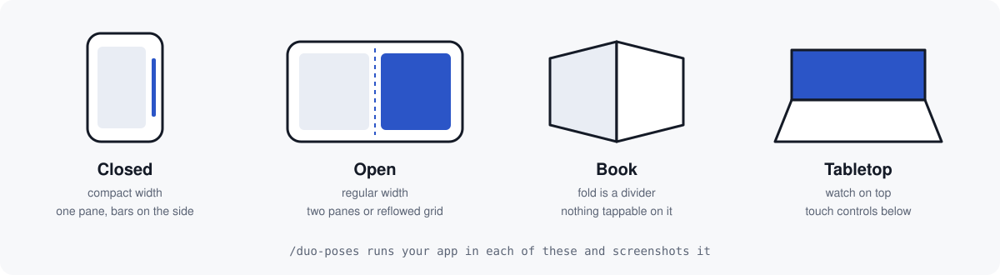

<div align="center">

[English](../../README.md) · **Français**

<picture>
  <source media="(prefers-color-scheme: dark)" srcset="../assets/banner-dark.svg" />
  <source media="(prefers-color-scheme: light)" srcset="../assets/banner-light.svg" />
  
</picture>

# Duology

### Des skills Claude Code pour concevoir, coder, tester et publier des apps sur iPhone Duo.

**Votre agent a appris iOS avant que l'iPhone Duo existe. Duology lui apprend le reste.**

[](https://github.com/Kimeur/duology/stargazers)
[](../../ROADMAP.md)
[](#contenu)
[](#recettes)
[](#vérifié-sur)
[](#démarrage-rapide)
[](https://skills.sh/Kimeur/duology)
[](https://github.com/Kimeur/duology/commits)
[](../../LICENSE)

[Démarrage rapide](#démarrage-rapide) · [Contenu](#contenu) · [Modèles](#modèles-de-mise-en-page) · [Recettes](#recettes) · [Preuves](#des-preuves-pas-des-promesses) · [FAQ](#faq) · [Feuille de route](../../ROADMAP.md)

<code>/plugin marketplace add Kimeur/duology</code>

</div>

> [!IMPORTANT]
> **Duology se construit au grand jour.** La v0.1 (11 skills, `/duo-doctor`, `/duo-new`, `/duo-audit`) arrive d'ici le 30 octobre 2026. Le pack complet de 36 skills est prévu pour la v1.0, en janvier 2027. Tant que la v0.1 n'est pas publiée, les commandes d'installation ci-dessous ne fonctionnent pas encore. Ajoutez une étoile ou suivez le dépôt pour être prévenu de la sortie. Voir la [feuille de route](../../ROADMAP.md) (en anglais).

> [!NOTE]
> Duology est un projet communautaire. Il n'est ni affilié à Apple Inc., ni approuvé ou soutenu par Apple.
> iPhone est une marque d'Apple Inc. Chaque affirmation sur une API renvoie à la documentation d'Apple, listée dans [`reference/sources.md`](../../reference/sources.md).

<div align="center">
<br />

<br /><br />
</div>

---

## Le problème

L'iPhone Duo est en vente à partir du 23 octobre 2026. Il a un écran extérieur de 5,4″, un écran intérieur de 7,6″ et un pli. Les agents de code ont été entraînés avant sa sortie. Quand on leur demande de « faire marcher l'app sur Duo », ils écrivent le code qu'Apple déconseille :

- ils mesurent `UIScreen.main.bounds`, qui est ambigu sur un téléphone à deux écrans ;
- ils se basent sur l'orientation de l'appareil ou sur `userInterfaceIdiom`, et prennent « largeur régulière » pour « iPad » ;
- ils placent des boutons et du texte là où le téléphone se plie ;
- ils reconstruisent l'écran à l'ouverture, et vous perdez votre position de défilement, votre saisie ou votre vidéo ;
- ils conçoivent un seul écran et l'étirent, au lieu d'une mise en page pour chaque façon de tenir le téléphone.

Apple a publié les règles dans six Tech Talks, une page des Human Interface Guidelines et le SDK iOS 27.1. Duology en fait des skills que Claude Code charge quand il en a besoin, avec ce que nous avons appris en publiant une vraie app pour Duo.

### Ce que Duology change

1. **Il connaît l'appareil.** Classes de taille, régions réservées, `ArrangementView`, barres verticales et charnière. Chaque fait est vérifié dans le SDK iOS 27.1. Les scènes et les caméras auront leurs propres skills en v0.2 et v0.3.
2. **Il conçoit, il ne se contente pas de compiler.** Huit modèles de mise en page nommés, un état qui survit au pliage et au dépliage, et deux personnes sur un même écran, chacun avec du code SwiftUI. Les conseils pour chaque position, les transitions et la portée du pouce arrivent en v0.2.
3. **Il crée des apps complètes.** Une recette crée un projet qui se compile et tourne sur le simulateur iPhone Duo. La v0.1 contient la première, un jeu à deux joueurs. Sept autres sont prévues.
4. **Il vérifie son propre travail.** `duo-lint` trouve le code qu'Apple déconseille. `/duo-audit` y ajoute une grille de 15 points appliquée à des captures du simulateur. Une vérification qui capture chaque position (`/duo-poses`) est prévue pour la v0.2.

<div align="center">

</div>

## Démarrage rapide

<details open>
<summary><strong>Claude Code</strong> · marketplace de plugins</summary>

**Il vous faut :** un Mac avec puce Apple, [Xcode 27.1](https://developer.apple.com/news/releases/) (27A9275 ou plus récent) et Claude Code.

```bash
/plugin marketplace add Kimeur/duology
/plugin install duology@duology
```

Ajoutez les autres plugins quand vous en avez besoin :

```bash
/plugin install duology-design@duology
/plugin install duology-recipes@duology
/plugin install duology-ship@duology
```

`duology-recipes` et `duology-ship` ont besoin de `duology`, qui leur fournit `/duo-doctor`. Un cinquième plugin, `duology-features`, est prévu pour la v0.3.

Redémarrez Claude Code, puis vérifiez votre installation :

```
/duo-doctor
```

Il vérifie macOS, Xcode 27.1, le runtime du simulateur iOS 27.1, un simulateur iPhone Duo, le pont agent d'Xcode (`xcrun mcpbridge`) et Python pour `duo-lint`. Il explique comment corriger chaque échec et ne modifie rien de lui-même.

</details>

<details>
<summary><strong>Cursor, Codex, Copilot, Gemini CLI et les autres</strong> · skills seuls</summary>

```bash
npx skills add Kimeur/duology
```

La CLI détecte votre agent et place les skills là où il les cherche. Vous obtenez tous les skills. Les commandes slash et le hook de lint sont propres à Claude Code ; avec un autre agent, demandez-les en toutes lettres (« lance l'audit Duo »). [AGENTS.md](../../AGENTS.md) (en anglais) donne le script derrière chaque commande.

Un seul skill :

```bash
npx skills add Kimeur/duology --skill duo-layout
```

Chaque skill fonctionne seul : les liens qui sortent de son dossier pointent vers ce dépôt sur GitHub.

</details>

<details>
<summary><strong>Manuel</strong></summary>

Chaque skill est un dossier avec un `SKILL.md`. Copiez ceux que vous voulez dans `.claude/skills/` (pour le projet) ou `~/.claude/skills/` (pour tout ce Mac).

</details>

### Demandez à Claude

```text
Adapte mon app à l'iPhone Duo. Commence par un audit, corrige ce qu'il
trouve, puis lance-la sur le simulateur Duo.
```

```text
/duo-new recipe-two-player-game TapDuel
Un jeu de réflexes : chaque joueur touche ses propres cibles, le premier à dix gagne.
```

```text
Passe en revue ces maquettes Figma pour iPhone Duo et dis-moi ce qui casse quand le téléphone est à moitié plié.
```

## Contenu

**v0.1 : 11 skills dans 4 plugins, plus 3 commandes.** Le pack complet prévoit 36 skills dans 5 plugins, 6 commandes et 2 agents de revue. Les lignes marquées *prévu* ne sont pas encore construites ; la [feuille de route](../../ROADMAP.md) indique quand elles arrivent. Claude ne charge un skill que lorsque la tâche l'exige, donc le pack ne coûte presque rien tant qu'il ne sert pas.

<details open>
<summary><strong>duology</strong> · les bases : installation, mise en page, continuité</summary>

| Skill | Statut | À utiliser quand |
|---|---|---|
| `duo-start` | v0.1 | Vous ne savez pas par où commencer. Il détermine SwiftUI ou UIKit, app nouvelle ou existante, et choisit les bons skills. |
| `duo-setup` | v0.1 | Vous installez Xcode 27.1 à côté d'un Xcode plus ancien, Device Hub, la connexion agent d'Xcode, les réglages de projet Swift 6. |
| `duo-layout` | v0.1 | Du contenu tombe dans le pli. Classes de taille, zones de sécurité inégales, régions réservées, `ArrangementView` et quand préférer votre propre découpage. |
| `duo-navigation` | v0.1 | Barres d'outils et barres d'onglets. Barres verticales, onglets qui deviennent une barre latérale, `NavigationSplitView`, feuilles, débordement. |
| `duo-continuity` | v0.1 | Quelque chose se réinitialise quand vous pliez. Défilement, lecture, texte saisi, sélection et navigation survivent au pliage, au dépliage, à la rotation et au redimensionnement. |
| `duo-scenes` | prévu (v0.2) | Plusieurs fenêtres, Split View, et afficher quelque chose sur l'écran extérieur pendant que l'intérieur est utilisé. |

</details>

<details>
<summary><strong>duology-design</strong> · design et interaction</summary>

| Skill | Statut | À utiliser quand |
|---|---|---|
| `duo-design-system` | prévu (v0.2) | Vous posez les espacements, les grilles (nombre pair de colonnes), la typographie pour les deux écrans, Liquid Glass d'iOS 27, les coins, les zones tactiles. |
| `duo-patterns` | v0.1 | Vous choisissez une mise en page. Liste-détail, panneau d'appoint, deux pages, double vue, canevas étendu, flux réorganisé, onglets vers barre latérale, déplacement. |
| `duo-postures` | prévu (v0.2) | Vous concevez pour les positions livre, table, debout et retourné. La charnière comme commande, avec parcimonie. |
| `duo-transitions` | prévu (v0.2) | Le passage de fermé à ouvert doit donner l'impression d'une seule app, pas d'un rechargement. |
| `duo-ergonomics` | prévu (v0.2) | Prise à deux mains, portée du pouce, commandes sur le bord. |
| `duo-shared-screen` | v0.1 | Deux personnes utilisent un seul téléphone : jeux, enseignement, montrer quelque chose à un client. |
| `duo-accessibility` | prévu (v0.2) | Ordre VoiceOver entre les panneaux, Dynamic Type sur les deux écrans, Réduire les animations, clavier physique. |
| `duo-design-review` | v0.1 | Vous passez en revue des captures ou des maquettes Figma avec la grille Duo de 15 points. |

</details>

<details>
<summary><strong>duology-features</strong> · les nouveautés d'iOS 27 sur deux écrans · prévu (v0.3)</summary>

| Skill | Statut | À utiliser quand |
|---|---|---|
| `duo-intelligence` | prévu (v0.3) | Vous ajoutez Foundation Models : un panneau IA quand le téléphone est ouvert, un court résumé quand il est fermé. |
| `duo-app-intents` | prévu (v0.3) | Siri, actions d'app et conscience de l'écran avec App Intents. |
| `duo-camera` | prévu (v0.3) | Apps de capture. Chaque caméra selon son orientation, la caméra frontale virtuelle, un aperçu sur l'écran extérieur. |
| `duo-media` | prévu (v0.3) | Vidéo et audio. Lecteur en position table, Picture in Picture, « à suivre ». |
| `duo-reading` | prévu (v0.3) | Livres et documents. Deux pages en position livre, des notes à côté du texte. |
| `duo-games` | prévu (v0.3) | Jeux. Remplir l'écran dans chaque position, garder les commandes tactiles hors du pli. |
| `duo-swiftui-27` | prévu (v0.3) | Les nouveautés SwiftUI d'iOS 27 qui comptent sur Duo : réorganisation, actions de balayage sur n'importe quelle vue, la macro `@State`, les nouvelles API de barre d'outils. |
| `duo-system-surfaces` | prévu (v0.3) | Widgets, Activités en direct, StandBy et Commandes sur l'un ou l'autre écran. |

</details>

<details>
<summary><strong>duology-recipes</strong> · recettes d'apps</summary>

Voir [Recettes](#recettes).

</details>

<details>
<summary><strong>duology-ship</strong> · tests et App Store</summary>

| Skill | Statut | À utiliser quand |
|---|---|---|
| `duo-testing` | v0.1 | Vous écrivez des tests qui tiennent sur le simulateur Duo : logique testée sur le Mac, options de lancement, tests d'interface qui atteignent vraiment les gestes SwiftUI. |
| `duo-pose-matrix` | prévu (v0.2) | Vous vérifiez chaque position avec des captures et l'arbre d'accessibilité. |
| `duo-lint` | v0.1 | Vous cherchez le code qu'Apple déconseille avant la publication. |
| `duo-performance` | prévu (v1.0) | Un redimensionnement fluide à 120 Hz quand le téléphone s'ouvre. |
| `duo-app-store` | prévu (v1.0) | Captures Duo (obligatoires à partir d'avril 2027), métadonnées, notes pour l'App Review, manifeste de confidentialité. |
| `duo-migrate` | prévu (v1.0) | Vous adaptez une app existante : le SDK utilisé pour compiler change son rendu sur Duo. |

</details>

### Commandes et agents

| Commande | Statut | Ce qu'elle fait |
|---|---|---|
| `/duo-doctor` | v0.1 | Vérifie le Mac : Xcode 27.1, le runtime iOS 27.1, un simulateur iPhone Duo, le pont agent d'Xcode et Python. |
| `/duo-new <recette> <NomApp>` | v0.1 | Crée une app à partir d'une recette, teste ses règles sur le Mac, la compile et la lance sur le simulateur Duo. |
| `/duo-audit` | v0.1 | Lance `duo-lint` et la grille de 15 points sur votre app, puis liste ce qu'il faut corriger, du plus grave au moins grave. |
| `/duo-poses` | prévu (v0.2) | Lance votre app fermée, ouverte, en position livre et sur table, et enregistre une capture de chaque position. |
| `/duo-review` | prévu (v0.2) | Critique de design de captures ou de maquettes Figma. |
| `/duo-ship` | prévu (v1.0) | Liste de contrôle App Store pour Duo : captures, métadonnées, notes pour l'App Review. |

| Agent | Statut | Ce qu'il fait |
|---|---|---|
| `duo-design-reviewer` | prévu (v0.2) | Passe un écran en revue comme le ferait un responsable design Duo, avec la règle derrière chaque remarque. |
| `duo-pose-tester` | prévu (v1.0) | Lance la vérification des positions et signale chaque échec avec sa capture. |

<details>
<summary><strong>duo-lint</strong> · exemple de rapport</summary>

Sortie réelle sur [`evals/fixtures/Places`](../../evals/fixtures/Places), une app d'exemple où des erreurs ont été placées exprès pour les évaluations. Quatre de ses huit résultats :

```text
$ duo-lint Places
Places/App/RootView.swift:17          DUO004  warning  userInterfaceIdiom == .pad    layout picked by device type; pick it by size class or space
Places/List/PlaceRow.swift:9          DUO001  error    UIScreen.main.bounds          your window is not the screen on a two-display phone; size from the view or window
Places/List/PlacesScreen.swift:8      DUO005  warning  regular width as iPad         size class treated as a device; iPhone Duo gets regular and compact widths
Places/List/PlacesScreen.swift:97     DUO007  warning  frame(width: 390)             fixed width of 320 pt or more; let the container size it
8 findings · 3 errors · 5 warnings (10 files checked)
```

Il a neuf règles (`DUO001` à `DUO009`) et produit du texte, du JSON ou des annotations GitHub. Ses messages sont en anglais. Activez le hook facultatif (`export DUOLOGY_LINT_HOOK=1` avant de lancer Claude Code) et Claude voit ces résultats juste après avoir modifié un fichier Swift. Le hook ne bloque jamais une modification.

</details>

## Modèles de mise en page

Chaque modèle de `duo-patterns` est livré avec une recette SwiftUI et un écran dans l'app galerie ([`samples/DuologyGallery`](../../samples/DuologyGallery)).

| Modèle | Fermé | Ouvert | Idéal pour |
|---|---|---|---|
| Liste-détail | la liste, puis le détail | les deux côte à côte | mail, messages, réglages |
| Panneau d'appoint | le contenu, le panneau dans une feuille | le contenu avec un panneau plus étroit | commentaires, outils, « à suivre » |
| Deux pages | une page | deux pages, une de chaque côté | livres, documents, diapositives |
| Double vue | une vue, un sélecteur | les mêmes données de deux façons | liste et carte, texte et aperçu |
| Canevas étendu | le canevas | le canevas passe sur le pli, les outils l'évitent | cartes, dessin, grands tableaux |
| Flux réorganisé | 1 ou 2 colonnes | un nombre pair de colonnes | photos, boutiques, actualités |
| Onglets vers barre latérale | barre d'onglets sur le côté | barre latérale | apps avec beaucoup de sections |
| Déplacement | sans objet | les commandes quittent le pli, le contenu qui défile reste en place | tout écran avec des commandes près du centre |

L'app galerie sur le simulateur iPhone Duo (iOS 27.1), fermé, sur l'écran extérieur. Les captures ouvert et à moitié plié viendront plus tard ; le [README de la galerie](../../samples/DuologyGallery/README.md#add-screenshots-of-other-poses) (en anglais) explique comment les faire.

| Liste-détail | Panneau d'appoint | Deux pages | Double vue |
|---|---|---|---|
|  |  |  |  |
| **Canevas étendu** | **Flux réorganisé** | **Onglets vers barre latérale** | **Déplacement** |
|  |  |  |  |

## Recettes

`/duo-new <recette> <NomApp>` crée le projet, teste ses règles sur le Mac, le compile et l'ouvre sur le simulateur iPhone Duo. La v0.1 contient une recette ; les autres sont prévues.

| Recette | Statut | Ce que vous obtenez |
|---|---|---|
| `recipe-two-player-game` | v0.1 | Chaque joueur a la moitié de l'écran dans chaque position, avec la logique du jeu testée sur le Mac. |
| `recipe-finance-dashboard` | prévu (v0.3) | Le solde quand le téléphone est fermé ; solde, graphiques et transactions quand il est ouvert. |
| `recipe-media-player` | prévu (v0.3) | Un lecteur qui passe tout seul en position table, avec « à suivre » et Picture in Picture. |
| `recipe-reader` | prévu (v0.3) | Deux pages en position livre, et il se souvient où vous en étiez. |
| `recipe-shop` | prévu (v0.3) | Le rayon de produits à côté de la fiche produit, avec un paywall sur deux panneaux. |
| `recipe-notes-ai` | prévu (v1.0) | Liste de notes et éditeur, avec un panneau de résumé IA sur l'écran intérieur. |
| `recipe-camera-studio` | prévu (v1.0) | La personne filmée se voit sur l'écran extérieur. |
| `recipe-kids-learning` | prévu (v1.0) | Un contrôle parental, un manifeste de confidentialité, et aucun suivi. |

## Des preuves, pas des promesses

Chaque skill de la v0.1 a des tâches de test dans [`evals/`](../../evals), 20 pour l'instant. Chaque tâche est lancée deux fois avec Claude Code, avec et sans Duology, dans une copie neuve du même projet d'exemple. Un essai réussit quand l'app se compile pour le simulateur iPhone Duo, que `duo-lint` ne trouve rien, que chaque vérification de la tâche passe et que chaque règle de la grille qu'elle couvre passe.

Pas encore de résultats. Les premiers essais arrivent avec la v0.1, et nous les publierons ici, quels qu'ils soient.

| Tâche | Sans Duology | Avec Duology |
|---|---|---|
| Faire marcher une app de liste existante sur Duo | *en attente* | *en attente* |
| Garder la vidéo en lecture pendant le pliage et le dépliage | *en attente* | *en attente* |
| Créer un jeu à deux joueurs sur un seul téléphone | *en attente* | *en attente* |
| Mise en page sur table pour un appel vidéo | *en attente* | *en attente* |

Comment fonctionnent les essais et comment les relancer : [`evals/README.md`](../../evals/README.md) (en anglais).

### Vérifié sur

| | Statut |
|---|---|
| Xcode 27.1 (27A9275) | Vérifié |
| Simulateur iPhone Duo, iOS 27.1 | Vérifié |
| iPhone Duo réel | Prévu pour la v0.2 |
| iOS 27.2 bêta | Pas suivi avant sa sortie |

Chaque `SKILL.md` le répète dans son en-tête, pour que vous sachiez jusqu'où chaque règle a été testée.

## FAQ

<details>
<summary><strong>Qu'est-ce qui distingue Duology des autres dépôts de skills pour iPhone Duo ?</strong></summary>

D'autres dépôts expliquent bien les API du Duo, et [mirzaaghazadeh/iphone-duo-skills](https://github.com/mirzaaghazadeh/iphone-duo-skills) couvre aussi Flutter, React Native et Capacitor. Duology vise tout le parcours, du design à l'App Store, pour les apps natives SwiftUI et UIKit. La v0.1 contient des modèles de mise en page, une recette, un linter, une commande d'audit et un banc d'essai. La vérification des positions, le skill App Store et les résultats publiés viendront ensuite.

</details>

<details>
<summary><strong>Xcode 27 fournit déjà des skills pour agents. Pourquoi en ajouter ?</strong></summary>

Les skills d'Apple (exportez-les avec `xcrun agent skills export`) couvrent SwiftUI en général et le redimensionnement des apps. Duology y renvoie sans les copier. Il ajoute ce qu'ils ne couvrent pas : le design pour chaque position, l'usage à deux, les recettes et la vérification.

</details>

<details>
<summary><strong>Ai-je besoin d'un iPhone Duo ?</strong></summary>

Non. Tout tourne sur le simulateur iPhone Duo d'Xcode 27.1. Quelques points ne se voient que sur un vrai appareil (la sensation de la charnière, le passage d'une caméra à l'autre, les transitions à 120 Hz) ; les skills concernés le signalent.

</details>

<details>
<summary><strong>Est-ce que ça marche avec UIKit ?</strong></summary>

Oui. `duo-layout`, `duo-navigation`, `duo-continuity` et `duo-shared-screen` donnent une version SwiftUI et une version UIKit. `duo-patterns` construit en SwiftUI et indique l'équivalent UIKit de chaque modèle. La recette à deux joueurs est en SwiftUI.

</details>

<details>
<summary><strong>Duology envoie-t-il des données quelque part ?</strong></summary>

Non. Les skills sont des fichiers texte, et `duo-lint` et `duo-doctor` tournent sur votre Mac.

</details>

## Documentation

Ces documents sont en anglais.

- [Feuille de route](../../ROADMAP.md) : ce qui est prévu, et quand.
- [Journal des modifications](../../CHANGELOG.md) : ce qui change à chaque version.
- [AGENTS.md](../../AGENTS.md) : utiliser Duology avec Codex, Cursor, Copilot, Gemini CLI et d'autres agents.
- [App galerie](../../samples/DuologyGallery/README.md) : comment la lancer et ce que montre chaque écran.
- [Évaluations](../../evals/README.md) : comment fonctionnent les essais.
- [Faits sur l'appareil](../../reference/device-facts.md) : écrans, caméras, positions, classes de taille.
- [Index des API](../../reference/api-index.md) : chaque API Duo avec son lien vers la documentation Apple.
- [Sources](../../reference/sources.md) : les pages et les talks d'Apple derrière chaque règle.
- [Contribuer](../../CONTRIBUTING.md) : comment ajouter un skill, un modèle ou une recette.
- [Sécurité](../../SECURITY.md) : comment signaler un problème de sécurité.

## Historique des étoiles

<a href="https://www.star-history.com/?repos=Kimeur%2Fduology&amp;type=date">
  <picture>
    <source media="(prefers-color-scheme: dark)" srcset="https://api.star-history.com/chart?repos=Kimeur/duology&amp;type=date&amp;theme=dark&amp;legend=top-left" />
    <source media="(prefers-color-scheme: light)" srcset="https://api.star-history.com/chart?repos=Kimeur/duology&amp;type=date" />
    
  </picture>
</a>

## Contribuer

Les pull requests sont les bienvenues, en particulier les nouveaux modèles, recettes et tâches de test. Chaque modification doit avoir :

- un lien vers la documentation ou le talk d'Apple derrière toute affirmation sur une API ;
- une tâche de test dans `evals/` pour tout nouveau skill ;
- une ligne `verified:` qui dit où vous l'avez testée.

Lisez [CONTRIBUTING.md](../../CONTRIBUTING.md) (en anglais) avant de commencer. Vous avez trouvé une affirmation fausse sur une API ? [Ouvrez une issue](https://github.com/Kimeur/duology/issues/new?template=api-correction.yml) avec le lien Apple.

## Remerciements

Construit sur les Tech Talks iPhone Duo et les Human Interface Guidelines d'Apple, et sur des idées de design venues des modèles du Surface Duo de Microsoft, des mises en page adaptatives d'Android et du mode Flex de Samsung. Merci à la communauté des skills Swift pour agents : [twostraws](https://github.com/twostraws/Swift-Agent-Skills), [AvdLee](https://github.com/AvdLee/SwiftUI-Agent-Skill), [Dimillian](https://github.com/Dimillian/Skills) et [mirzaaghazadeh](https://github.com/mirzaaghazadeh/iphone-duo-skills).

## Licence

[MIT](../../LICENSE). La documentation d'Apple est citée par des liens, jamais copiée. Apple, iPhone et Xcode sont des marques d'Apple Inc.
