# Duology Gallery

A small SwiftUI app with one screen for each layout pattern in the [`duo-patterns`](../../plugins/duology-design/skills/duo-patterns/SKILL.md) skill. Run it on the iPhone Duo simulator, then close, open and fold the phone in Device Hub to see what each pattern does.

Every screen uses real sample content (an inbox, an article, a short book, a day in Lisbon, a trail map, a shop, a music library, voice memos). All names, companies and text are made up for the sample.

<p align="center">
  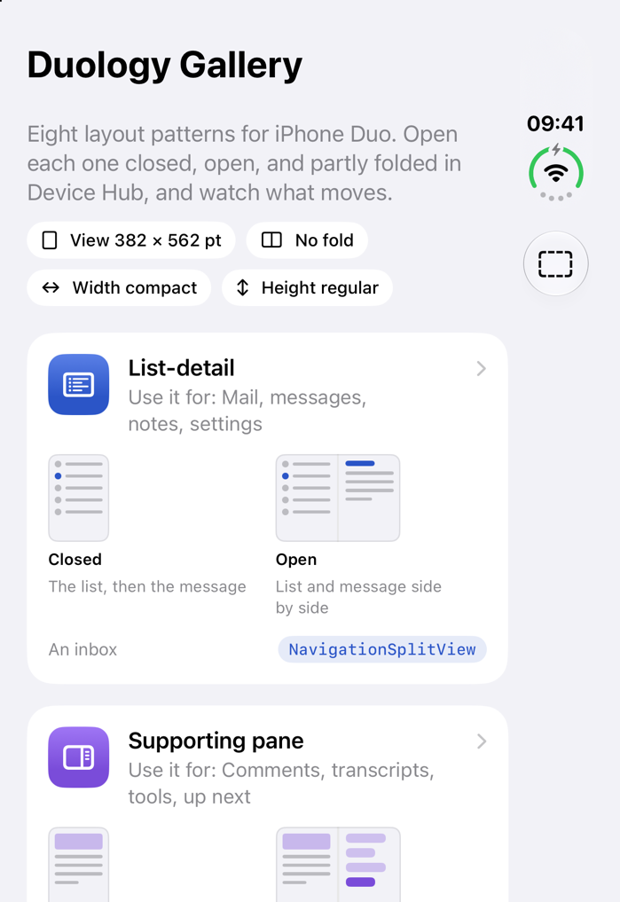
</p>

## What you need

- A Mac with Apple silicon and [Xcode 27.1](https://developer.apple.com/news/releases/) (27A9275 or later).
- The iPhone Duo simulator with iOS 27.1. It ships with Xcode 27.1.

The app targets iOS 26.0, so it also runs on older iPhones and on iPad. The Duo-only APIs sit behind `if #available(iOS 27.1, *)` (or 27.0), and each screen has a plain fallback.

## Run it

In Xcode: open `DuologyGallery.xcodeproj`, pick **iPhone Duo** as the run destination, and press Run. No signing team is needed for the simulator.

From the command line:

```bash
cd samples/DuologyGallery
export DEVELOPER_DIR=/Applications/Xcode-27.1.app/Contents/Developer

xcodebuild -project DuologyGallery.xcodeproj -scheme DuologyGallery \
  -destination 'platform=iOS Simulator,name=iPhone Duo' \
  -derivedDataPath build CODE_SIGNING_ALLOWED=NO build

xcrun simctl boot "iPhone Duo"   # skip if it is already booted
xcrun simctl install "iPhone Duo" build/Build/Products/Debug-iphonesimulator/DuologyGallery.app
xcrun simctl launch "iPhone Duo" dev.duology.gallery -pattern listDetail
```

`DEVELOPER_DIR` picks Xcode 27.1 for these commands only. You don't need `xcode-select`.

### Launch arguments

| Argument | What it does |
|---|---|
| `-pattern <name>` | Opens one screen straight away. Names: `listDetail`, `supportingPane`, `twoPage`, `dualView`, `extendedCanvas`, `feedReflow`, `tabsToSidebar`, `displacement`. |
| `-showsRegions YES` | Draws every reserved region over the screen (the fold in pink, cameras and the status bar corner in orange) and lists their frames and the window size. Same as the dashed-rectangle button on the home screen. |
| `-select <id>` | Preselects an item: a message in list-detail, a place in dual view. |
| `-show map` | Starts the dual view on its map when only one view fits. |

The shared scheme lists the `-pattern` and `-showsRegions` arguments, turned off. Tick one in **Product > Scheme > Edit Scheme > Run > Arguments**.

### Try the poses

Poses change only in Device Hub: the **Closed**, **Partially Open** and **Open** buttons under the bezel, plus the rotate buttons. Hold Option and drag the slider under the bezel for any angle. `simctl` in Xcode 27.1 has no pose command ([Device Hub guide](https://developer.apple.com/documentation/xcode/interacting-with-your-app-in-device-hub)).

For each screen, check:

1. **Closed**, portrait and sideways.
2. **Open**, held wide and held tall.
3. **Partially Open**, held like a book: nothing you can tap sits in the fold.
4. **Split View** on the inner display: drag the app by its home indicator to one side.
5. Fold and unfold mid-task. Selection, scroll position, page and drafts must survive.

## The screens

Screenshots: iPhone Duo simulator, iOS 27.1, Xcode 27.1, **Closed pose, portrait, outer display**, light mode, 16 October 2026. Taken with `xcrun simctl io <device> screenshot --display=primary` at 1398 × 2034 px and scaled to half size for this page. Open and partly folded screenshots still need to be taken by hand in Device Hub (see [Add screenshots of other poses](#add-screenshots-of-other-poses)).

| Screen | Use it for | What it shows | Built with | Closed |
|---|---|---|---|---|
| [List-detail](DuologyGallery/Patterns/ListDetailView.swift) | Mail, messages, notes, settings | An inbox. Closed: the list, then the message with Back. Open: both side by side. Partly folded, the system evens the columns out. List actions stay above the list; message actions go to the vertical bar. | `NavigationSplitView(preferredCompactColumn:)`, `@SceneStorage` selection | 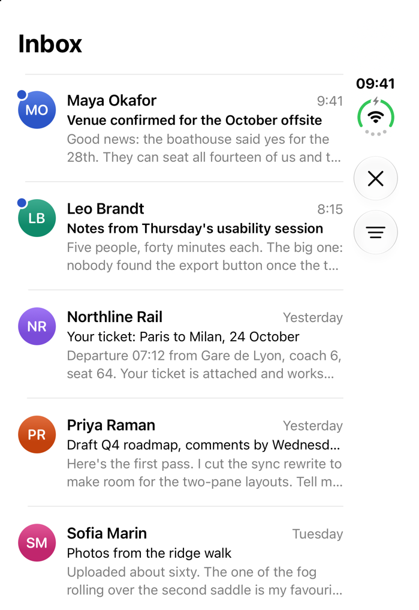 |
| [Supporting pane](DuologyGallery/Patterns/SupportingPaneView.swift) | Comments, transcripts, tools, up next | An article and its discussion. Open and wide: the discussion beside the article, narrower. Otherwise a Discussion button opens the same pane in a sheet, with the same draft. | `ArrangementView`, `.split.axes(.horizontal)`, `splitArrangementLayoutRatio` (iOS 27.1) | 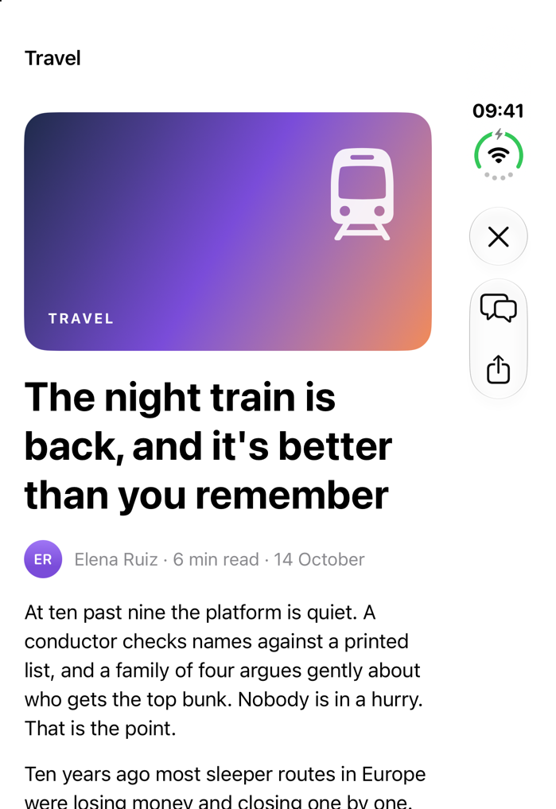 |
| [Two-page](DuologyGallery/Patterns/TwoPageView.swift) | Books, documents, slides | A short book. Closed: one page. Open and wide: two facing pages with the gap on the fold line. Spreads start on even pages, so pages don't swap sides when you fold. | `reservedRegions(kind: .division, options: .includeInactive)` (iOS 27.1), `@SceneStorage` page | 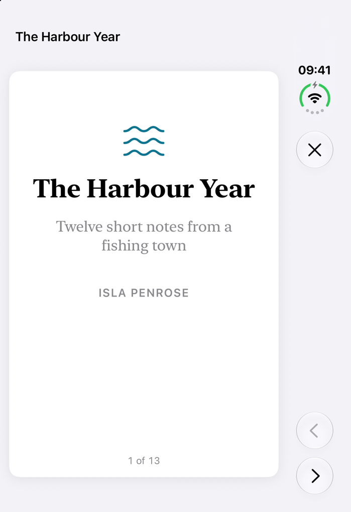 |
| [Dual view](DuologyGallery/Patterns/DualView.swift) | List and map, text and preview | A day of places in Lisbon. Open and wide: list leading, map trailing, one selection. Closed: one view and a List/Map switch. | `ArrangementView` (iOS 27.1), `Map(position:selection:)`, one `@Observable` model | 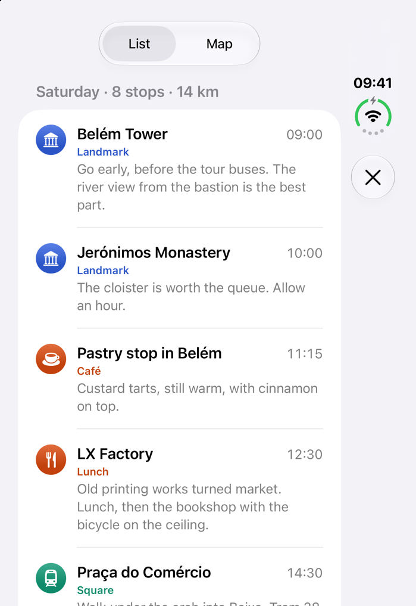 |
| [Extended canvas](DuologyGallery/Patterns/ExtendedCanvasView.swift) | Maps, drawing, big tables | A trail map you can pan and sketch on. The map fills the window, fold included. Only the tool palette moves: to the trailing region when folded like a book, to the bottom region when folded across. | `Canvas`, reserved regions (iOS 27.1), `glassEffect` (iOS 26) | 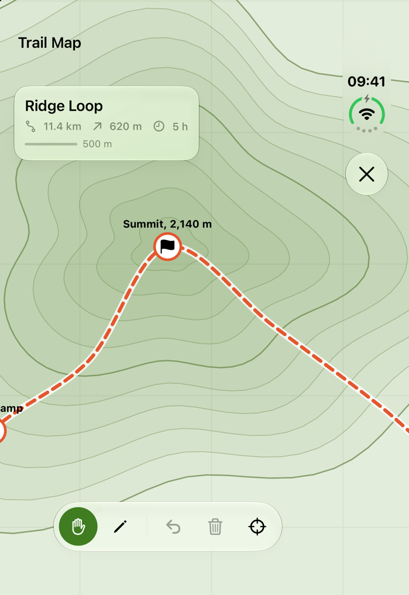 |
| [Feed reflow](DuologyGallery/Patterns/FeedReflowView.swift) | Photos, shops, news | A homeware shop. Columns come from the grid's own width; with a fold across the grid the count is even, and partly folded the fold becomes the middle gap. A line above the grid says what the grid is doing. | `LazyVGrid`, reserved regions with `.includeInactive`, `contentMargins(for: .container)` (iOS 27.1) | 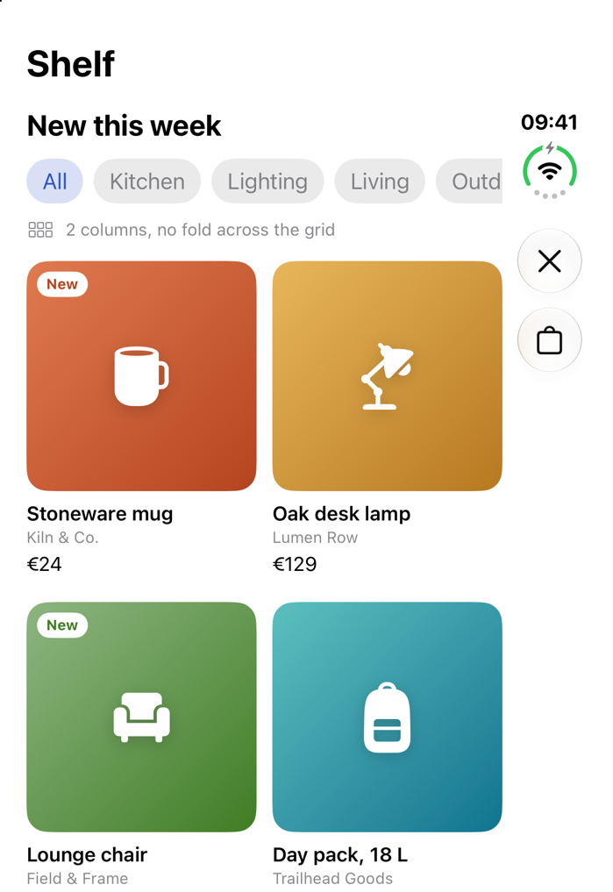 |
| [Tabs to sidebar](DuologyGallery/Patterns/TabsToSidebarView.swift) | Apps with many sections | A music library. Closed: a tab bar on the side. Open: a sidebar with a Library section. The Library shortcuts on Listen Now hide when the sidebar lists them. | `TabView`, `.sidebarAdaptable`, `defaultTabBarPlacement(.sidebar)` and `isTabViewSidebarAvailable` (iOS 27.0) | 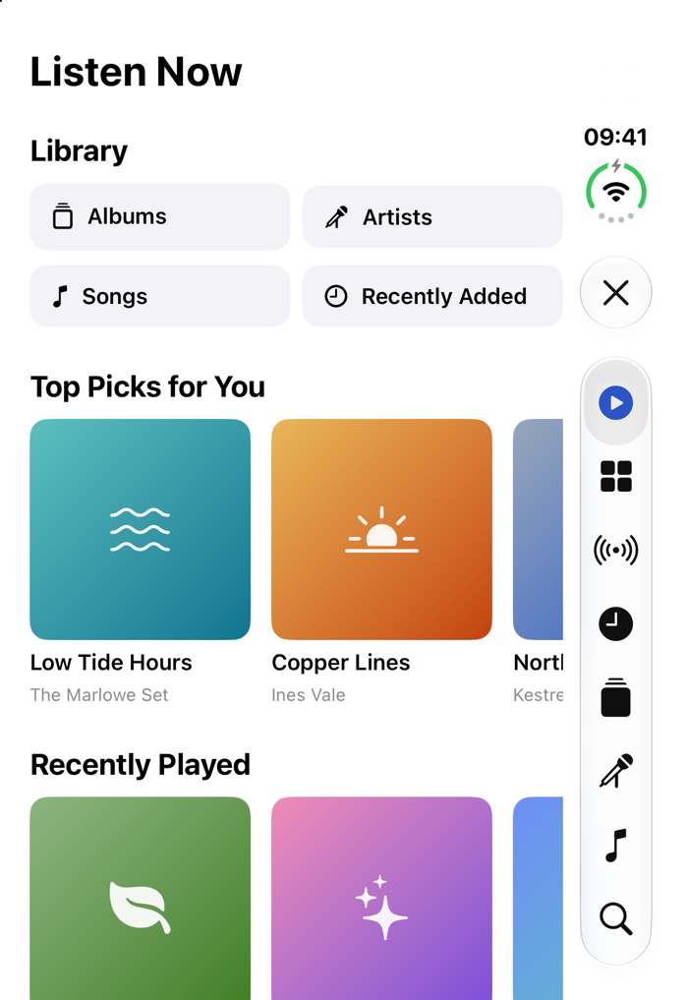 |
| [Displacement](DuologyGallery/Patterns/DisplacementView.swift) | Controls you place near the middle | Voice memos. The record group stays bottom centre when closed or flat. Partly folded it moves to the trailing region (book) or the bottom region (folded across). The list never moves. | `reservedRegions(kind: .division)` (iOS 27.1), `glassEffect` (iOS 26) | 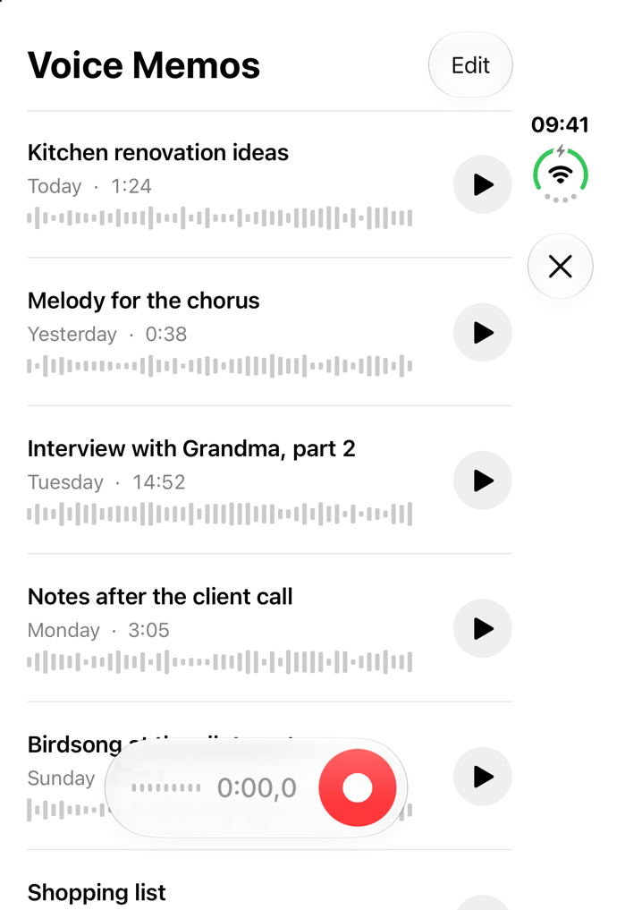 |

More closed screenshots:

| A message, closed | The map face of the dual view | Reserved regions, closed |
|---|---|---|
| 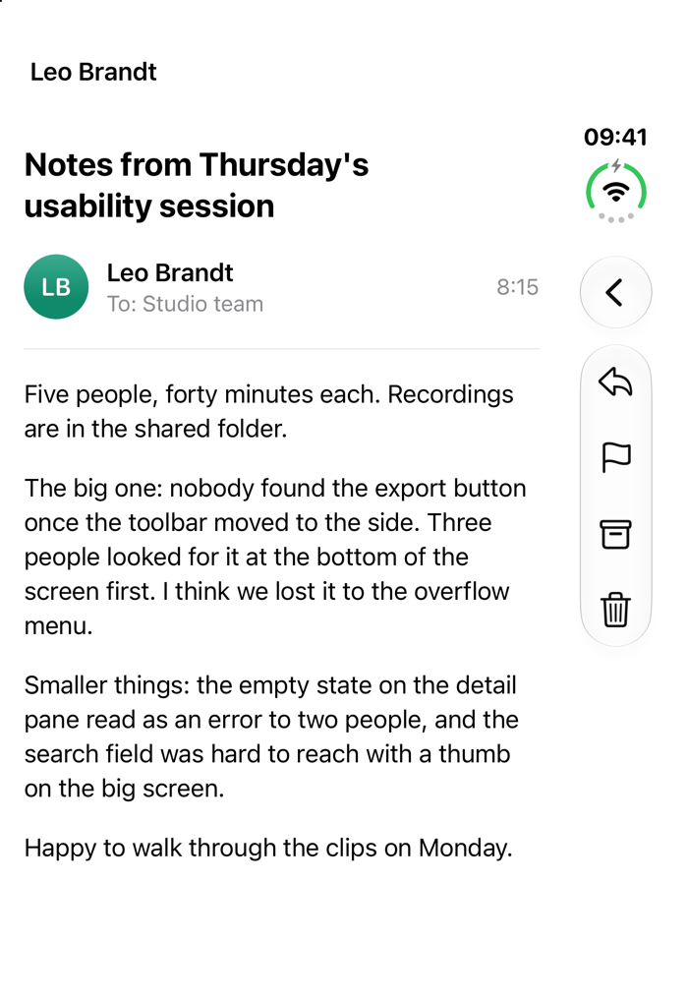 | 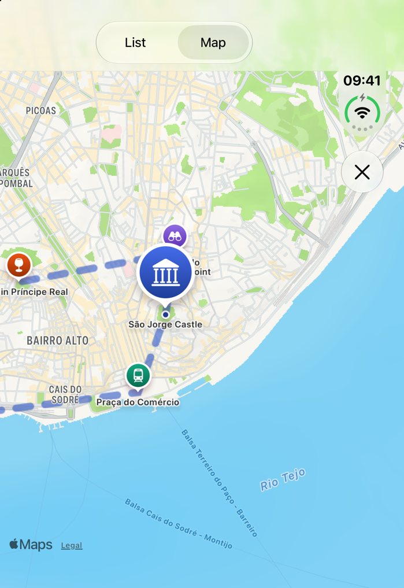 | 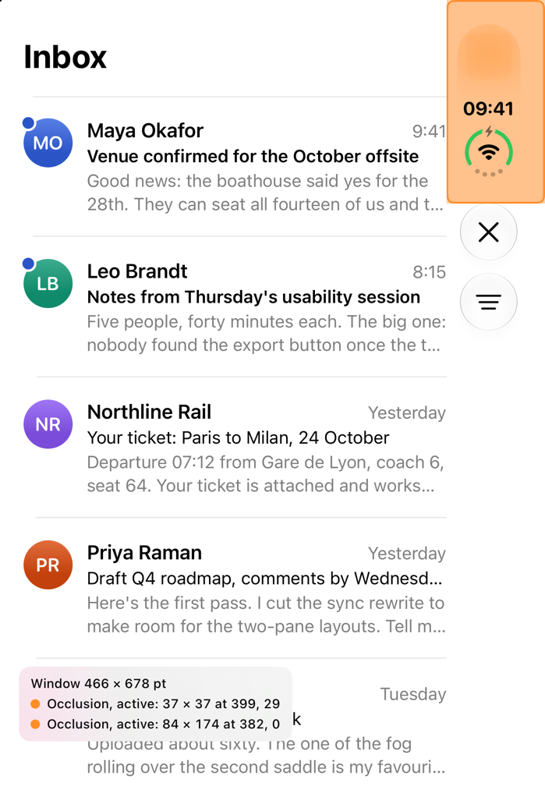 |
| `-pattern listDetail -select 2` | `-pattern dualView -show map -select 6` | `-pattern listDetail -showsRegions YES` |

## What we measured

On the iOS 27.1 iPhone Duo simulator, Closed, portrait, 16 October 2026:

- The window is 466 × 678 pt (read from the region overlay, which ignores the safe area).
- Two reserved regions, both `.occlusion` and both active: 84 × 174 pt at (382, 0), covering the status bar corner on the trailing side, and 37 × 37 pt at (399, 29) inside it. Which hardware each one stands for is our reading: the corner and the outer front camera. No `.division` region, as expected on the outer display.
- Toolbar items, the tab bar and the Close button all went into a vertical bar on the trailing side, under the status bar. Close sat at the top of the bar; bottom-bar items (the book's page buttons) sat at the bottom.
- `contentMargins(for: .container, edges: .horizontal)` gave a 20 pt leading margin and stopped content before the vertical bar.
- Horizontal `ScrollView`s inside those margins (the shop's category chips, the music shelves) drew their content past their frame, under the status bar and the tab bar, until we added `.clipped()`.

The same build ran every screen without a crash on an iPhone 17 Pro simulator with iOS 26.5, using the fallbacks.

Not checked yet: Open, Partially Open, held tall, Split View, right-to-left languages, and a real iPhone Duo.

## Add screenshots of other poses

1. Boot the iPhone Duo simulator and open it in Device Hub.
2. Pick a pose with the buttons under the bezel.
3. For each screen, launch it and save the display that is on:

```bash
xcrun simctl terminate "iPhone Duo" dev.duology.gallery
xcrun simctl launch "iPhone Duo" dev.duology.gallery -pattern twoPage
# Outer display (closed): --display=primary. Inner display (open): --display=primary-1.
xcrun simctl io "iPhone Duo" screenshot --display=primary-1 twoPage-open.png
sips -Z 1427 twoPage-open.png   # half of 2853 px, like the closed shots
```

Save them next to the others in [`docs/assets/gallery/`](../../docs/assets/gallery/) with the pose in the name (`twoPage-open.png`, `twoPage-partly-open.png`), and say the pose in the alt text.

## How the project is laid out

```text
DuologyGallery/
  App/
    DuologyGalleryApp.swift    app entry; patterns open as full-screen covers
    GalleryHome.swift          home grid, window facts, closed and open diagrams
    Pattern.swift              the eight patterns: names, one-liners, launch names
  Patterns/                    one file per pattern, each with its sample data
  Shared/
    EvenSplit.swift            two halves that always show (see below)
    FoldGeometry.swift         where the fold is, from the .division region
    FeedGrid.swift             even column counts around a fold
    ReservedRegionOverlay.swift  debug overlay for every reserved region
    GalleryChrome.swift        launch arguments, Close button, avatars
  Assets.xcassets              app icon (the Duology mark) and accent colour
```

The project uses file-system synchronized groups (`objectVersion = 77`). Add a Swift file to a folder and it builds; no project edit needed. Settings: Swift 6, `SWIFT_DEFAULT_ACTOR_ISOLATION = MainActor`, approachable concurrency on, iPhone and iPad, bundle ID `dev.duology.gallery`.

### Shared helpers

- **`EvenSplit`** puts two views side by side when it is wider than tall and stacks them otherwise, each in exactly half the space. Use it when both halves must stay on screen in every pose, such as two players or a before and after. `ArrangementView` may show only its primary view when space is tight, which is right for the other patterns but wrong there. The home screen's open diagrams use it. The same type is documented in the `duo-layout` skill.
- **`FoldGeometry`** and `onFoldChange(_:)` read the fold from `reservedRegions(kind: .division, options: .includeInactive)` on every geometry change. Ask for inactive regions too: a flat phone returns none by default. Before iOS 27.1 the modifier does nothing.
- **`feedColumns(for:minTileWidth:spacing:)`** is a pure function, so you can test it on the Mac. We did, with a 150 pt minimum tile and 12 pt spacing: 5 columns at 867 pt with no fold, 4 with an inactive fold, and with an active 40 pt fold the column widths and gaps add up to exactly 867 pt.
- **`controlRegion(in:fold:)`** returns where controls may sit: the whole view when flat, the trailing region when folded like a book, the bottom region when folded across.

## Rules the screens follow

- Layout comes from size class, the view's own size and reserved regions. No `UIScreen.main`, no `userInterfaceIdiom`, no orientation checks, no hinge angle, no fixed screen sizes.
- Navigation containers sit at the root of each screen. No `ArrangementView` inside a `NavigationSplitView`, `List` or `ScrollView`.
- System toolbars, sheets and dialogs do the fold avoidance they already know how to do. Code only moves controls the app places itself.
- Scrolling content never moves out of the fold. Only controls do.

Sources for each rule: [`reference/sources.md`](../../reference/sources.md). Every API with its availability: [`reference/api-index.md`](../../reference/api-index.md).

## License

MIT, like the rest of Duology. Map tiles in the dual view come from Apple Maps through MapKit.
